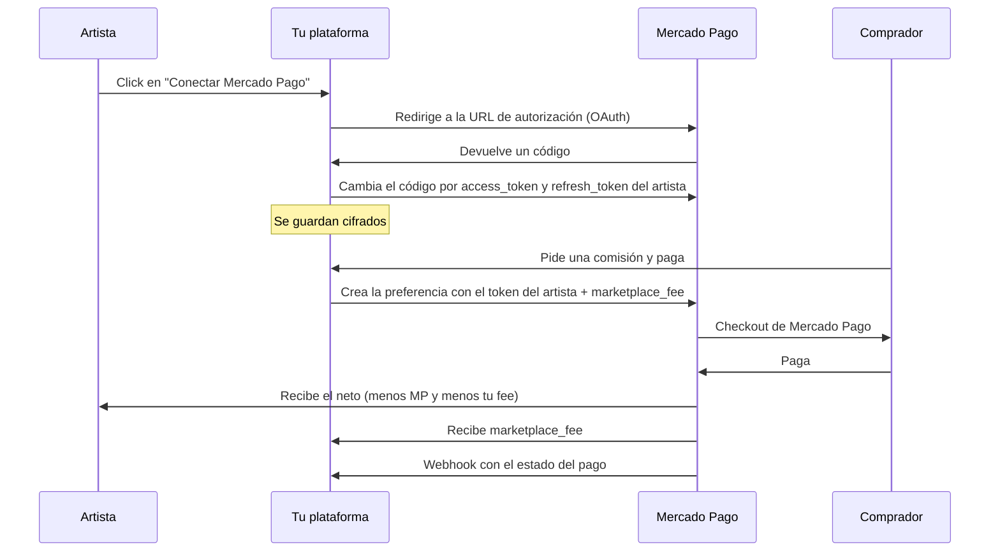

# 💳 Pagos: Mercado Pago (ARS) + AstroPay (USD)

> [!NOTE]
> Lo que sigue sale de búsquedas web, no de la documentación oficial. Antes de escribir código **confirmá cada punto en [mercadopago.com.ar/developers](https://www.mercadopago.com.ar/developers) y en [astropay.com/business](https://astropay.com/business)**.

## 0. Corrección de lo que dije antes
Con "sin pagos propios" me refería a **no cobrar dentro de la página**. Tenés razón: si la herramienta principal es simplificarle el cobro al artista, eso no tiene sentido. **El MVP tiene que cobrar.**

El nuevo orden:
| Moneda | Cómo | Estado |
|---|---|---|
| **ARS** | Mercado Pago, split 1:1 | Se puede arrancar ya: no pide volumen previo |
| **USD** | AstroPay | Hay que conseguir el acceso (ver sección 3) |

---

## 1. Cómo funciona el split de Mercado Pago (sin custodiar plata)

Es el modelo de **Marketplace**. El dinero va **directo a la cuenta del artista**, y Mercado Pago te deriva tu comisión a vos. Vos nunca tenés los fondos del artista.



### Pasos concretos
1. **Crear una aplicación** en el panel de desarrolladores de Mercado Pago.
2. **Conexión OAuth:** el artista autoriza tu app y te llegan `access_token`, `refresh_token` y su `user_id`. Los tokens vencen, así que hay que renovarlos con el refresh token.
3. **Al comprar,** tu backend crea una *preferencia de pago* usando **el access_token del artista** (no el tuyo) e incluyendo `marketplace_fee`.
4. Mercado Pago descuenta **primero su comisión** (que paga el artista) y después tu `marketplace_fee`.
5. **Webhooks** (`payment.updated`) para actualizar el estado del pedido.
6. **Conciliación:** hay un reporte de pagos divididos en la API de reportes.

Esquema ilustrativo (no copiar sin revisar la documentación):
```ts
// Con el access_token DEL ARTISTA (obtenido por OAuth)
const preference = await new Preference(artistClient).create({
  body: {
    items: [{ id: order.id, title: 'Comisión: busto a color', quantity: 1, unit_price: 30000 }],
    marketplace_fee: 1500,            // tu 5%, en ARS
    external_reference: order.id,
    notification_url: 'https://tu-sitio/api/mp/webhook',
    back_urls: { success: '...', failure: '...', pending: '...' },
  },
});
// redirigir al comprador a preference.init_point
```

### Requisitos que no te saltes
- Los artistas necesitan una **cuenta de Mercado Pago con identidad validada**.
- El split 1:1 es el estándar. El **1:N** (varias partes en un mismo pago) suele requerir contacto con un ejecutivo de MP.
- **Reembolsos:** hay que revisar cómo afectan a tu fee.
- **Seguridad legal:** seguí las reglas de la sección 1.1 para no convertirte en proveedor de servicios de pago.

---

## 1.1 Cómo hacerlo lo más seguro posible sin abogado

> [!WARNING]
> No soy abogado y esto no es asesoramiento legal. Reduce mucho el riesgo, pero no lo elimina. Lo bueno: según lo que encontré, las plataformas que **nunca tocan el dinero** y lo procesan por un PSP regulado (como Mercado Pago) **no necesitan registrarse ante el BCRA**. El esquema que armamos es justo ese. El riesgo aparece cuando el dinero **pasa por vos**.

### Reglas de oro (si las cumplís todas, estás en el modelo "sin custodia")
| # | Regla | Qué significa en la práctica |
|---|---|---|
| 1 | **La plata nunca pasa por tus manos** | Comprador → Mercado Pago → **cuenta del artista**. Vos solo recibís tu `marketplace_fee`. |
| 2 | **Nada de saldos ni retenciones propias** | Sin billetera interna, "créditos", ni "retengo hasta que se entregue". Si querés confianza, usá el **pago por etapas** (dos pagos directos al artista). |
| 3 | **Nunca recibas pagos "a tu nombre" para repartir** | Nada de "transferime a mí y yo le paso al artista". Ni siquiera como excepción. |
| 4 | **Nunca le pagues al artista desde tu cuenta** | Si tenés que mandarle plata a un artista, algo del diseño está mal. |
| 5 | **Que el KYC lo haga Mercado Pago/AstroPay** | El artista solo puede cobrar si conectó una cuenta ya verificada. Vos **no pedís ni guardás DNI**. |
| 6 | **No toques datos de tarjeta** | Con Checkout Pro el comprador paga en el sitio de Mercado Pago. Vos nunca ves la tarjeta. |
| 7 | **Dejá claro quién es quién en los Términos** | La plataforma es **intermediaria tecnológica**: el contrato de la comisión es **entre comprador y artista**. Los reembolsos y entregas los resuelve el artista. |
| 8 | **Solo mayores de 18 para cobrar** | Mercado Pago lo exige para cuentas verificadas. Los menores pueden tener portfolio, pero no cobrar. |
| 9 | **Facturá tu fee** | Inscribite en ARCA (monotributo) para facturar tu comisión como servicio de intermediación. Esto se puede hacer online. |
| 10 | **Política de privacidad y términos publicados** | Guardá solo los datos necesarios y decí qué hacés con ellos. |

### Cómo armar los Términos sin abogado
- Leé los de **VGen, BOOTH y Cafecito** (son públicos) y adaptá los puntos que aplican.
- Frases clave: "somos un intermediario tecnológico", "no somos parte del contrato entre comprador y artista", "los pagos los procesa Mercado Pago/AstroPay", "no custodiamos fondos".
- Definí una **ventana de cancelación clara** antes de que el artista empiece a trabajar. Para operaciones a distancia, la Ley de Defensa del Consumidor prevé un derecho de arrepentimiento, así que lo más seguro es no ir contra eso y dejarlo explícito. Las comisiones a medida pueden tener excepciones, pero eso sí no lo puedo asegurar.
- **Opciones gratuitas para una consulta puntual:** algunos consultorios jurídicos gratuitos de universidades públicas y colegios de abogados ofrecen orientación. No hace falta contratar a nadie, pero una revisión puntual de los Términos sería ideal si surge la posibilidad.

### Regla especial para AstroPay
Solo usalo si **AstroPay** recibe el pago del comprador y lo acredita **directo a la billetera del artista**. Si te piden que el dinero entre primero a **tu** cuenta y que después **vos** lo repartas, **no lo hagas**: ahí sí estarías custodiando fondos. En ese caso, **desistí del USD con AstroPay** (no de la app) y usá otra alternativa.

### Criterio de "no seguir"
Si una pasarela exige que vos recibas la plata de terceros, **esa pasarela no sirve para tu caso.** Es mejor lanzar solo con ARS por Mercado Pago que arriesgarte con un esquema dudoso.

---

## 2. ¿Se puede customizar el plazo de liberación?
**Seguramente tenés razón.** En lo que encontré, el plazo de liberación del dinero (`money_release_days`) es un ajuste **de la cuenta del vendedor** o de acuerdos comerciales especiales con Mercado Pago, no algo que se defina por pago en las integraciones estándar. No lo pude confirmar al 100%.

**Cambio de plan:** saco la idea de "defaultear a 10–18 días". En la planilla uso por defecto **liberación inmediata (12,6% total para el artista)**, que es el caso conservador. Cada artista elige su plazo en su cuenta de MP, y la plataforma puede mostrarles un tutorial: "Configurá tu plazo en *Tu negocio → Costos y cuotas*".

---

## 3. "Pago protegido" sin custodiar fondos
Un escrow real implica retener la plata, y eso complica lo regulatorio. Alternativa práctica para comisiones: **pago por etapas**.

| Etapa | Cuándo | Monto |
|---|---|---|
| Reserva | Al aceptar el pedido | 50% |
| Entrega | Al aprobar el boceto o el trabajo final | 50% |

- Son **dos pagos independientes**, cada uno va directo al artista.
- El comprador ve el avance y puede frenar el segundo pago si no se entrega.
- Los reembolsos los gestiona el artista desde Mercado Pago.
- Eso, más **reseñas, verificación y reglas claras de reembolso**, da bastante confianza sin guardar fondos.

---

## 4. Cómo conseguir acceso a la API de AstroPay sin volumen de ventas

### Lo que sé
Según lo que encontré, AstroPay for Business tiene:
- **Registro de comercios en línea** con verificación KYC/AML que puede tardar unas **48 horas**.
- **Entorno sandbox** con credenciales de prueba, normalmente **sin tener que hablar con ventas**.
- **Payouts** a billeteras de usuarios y soporte de ARS.
- En algunos casos, **promos de comisión 0% en los primeros 90 días** para comercios nuevos.
- Las integraciones más complejas (marketplace, split, volúmenes altos) **sí suelen pasar por el equipo comercial**.

No tengo confirmado qué requisitos pide para tu caso (persona física o jurídica, CUIT, rubro). **Lo averiguás en 20 minutos** registrándote.

### Plan en 5 pasos
| # | Paso | Detalle |
|---|---|---|
| 1 | **Registrate y pedí el sandbox** | Sin pitch, sin volumen. Con eso ya podés construir la integración. |
| 2 | **Construí primero Mercado Pago (ARS)** | Es tu prueba de que el producto funciona. |
| 3 | **Juntá tracción** | Artistas en lista de espera, compradores en lista de espera, resultados de la encuesta (en especial **A5: qué % de artistas prefiere recibir USD por AstroPay**), una landing y capturas del producto. |
| 4 | **Contactá con una propuesta de piloto** | Con los números de abajo y no con "no tengo volumen". |
| 5 | **Preguntas clave** | Ver la lista de más abajo. |

### Qué decirles cuando no tenés volumen
No pidas que confíen en tu volumen: **ofrecé un piloto**.
- **El problema:** artistas argentinos que venden a compradores del exterior y hoy usan métodos engorrosos.
- **Qué tenés:** lista de espera real, producto en sandbox, una comunidad concreta.
- **Qué querés:** un piloto con unos 30–50 artistas, volumen limitado, y que los resultados definan si se amplía.
- **Qué les aporta:** nuevos usuarios para su billetera en Argentina (cada artista se abre una cuenta) y un caso de uso claro.

**Proyecciones honestas para el pitch** (sacadas de la [planilla](file:///f:/repos/TuPuestito/docs/modelo_financiero.xlsx)):
| Horizonte | Artistas activos | GMV mensual |
|---|---|---|
| Piloto (meses 1–3) | 30–50 | US\$1.350–2.250 |
| 12 meses (base) | ~400 | ~US\$18.000 |

### Preguntas que tenés que hacerles
1. ¿Soportan **split** o sub-comercios, o **payouts a la billetera** del artista tras cada venta?
2. ¿**Quién hace el KYC** de cada artista? ¿Tienen que registrarse en AstroPay? *(ver "¿Qué es el KYC?" más abajo)*
3. ¿Los **compradores del exterior** pueden pagar con tarjeta internacional o solo con saldo AstroPay?
4. ¿El artista cobra en **USD** y puede retener o convertir a ARS?
5. ¿Qué **comisiones** hay para comprador, comercio y artista?
6. ¿Quién es el **comercio registrado** y quién responde por **contracargos**?
7. ¿Hay **límites** por artista (monotributistas, personas físicas)?
8. ¿Cuál es el **tiempo** de liquidación?
9. ¿Existe un **programa para startups** o un piloto con comisión reducida?

> [!IMPORTANT]
> Si el dinero pasa primero por una cuenta tuya y después se reparte, **estás custodiando fondos**. En ese caso no uses esa vía (ver sección 1.1).

### ¿Qué es el KYC?
**KYC** significa *Know Your Customer* ("conocé a tu cliente"). Es el proceso con el que un banco o billetera **verifica quién sos**: nombre, DNI (foto del frente y dorso), selfie para comprobar que sos vos, a veces CUIT, domicilio y de dónde viene tu dinero.

**Por qué existe:** la ley obliga a las entidades financieras y billeteras a prevenir el lavado de dinero y el fraude. Por eso nadie puede cobrar plata "anónimamente" en Mercado Pago o AstroPay.

**Por qué importa para vos:**
- El artista ya hizo su KYC cuando abrió su cuenta de Mercado Pago. Con AstroPay, lo mismo.
- Al preguntar *"¿quién hace el KYC?"* quiero saber si, para cobrar por tu plataforma, **AstroPay hace la verificación** (lo ideal) o te piden que **vos** recolectes los documentos de cada artista.
- Lo ideal es que **lo haga siempre la pasarela**. Si lo hicieras vos, tendrías que guardar DNI y fotos de miles de personas. Eso trae responsabilidad legal sobre datos sensibles y riesgo de filtraciones.

### Mail para el primer contacto (español)
> **Asunto:** Piloto de pagos en USD para artistas argentinos (Proyecto TuPuestito)
>
> Hola [nombre],
>
> Soy [tu nombre], desarrollador de **[nombre de la plataforma]**, un marketplace de comisiones de arte para artistas argentinos (similar a VGen o BOOTH, pensado para Argentina).
>
> Encuestamos a 25 artistas: el **72% pidió poder cobrar en USD/EUR** de forma simple, y el 84% quiere probar la plataforma. [Agregar: "X% prefiere recibir pagos por AstroPay".]
>
> Ya estoy integrando su sandbox y me gustaría proponerles un **piloto con 30–50 artistas**, con volumen limitado, para validar el caso de uso. ¿Podemos hablar 20 minutos o me indican a quién escribirle?
>
> Gracias,
> [Nombre] · [teléfono] · [link a la landing]

### Mail (inglés)
> **Subject:** USD payments pilot for Argentine artists (marketplace)
>
> Hi [name],
>
> I'm [name], founder of **[platform]**, a commission marketplace for Argentine artists (think VGen or BOOTH, built for Argentina).
>
> In our survey of 25 artists, **72% asked for simple USD/EUR payouts** and 84% want to join the beta. [X% would prefer AstroPay.]
>
> I'm integrating your sandbox and would like to propose a **pilot with 30–50 artists** with capped volume. Could we have a 20-minute call, or can you point me to the right person?
>
> Thanks,
> [Name]

### Dónde buscar un contacto
- **Formulario "Contact us"/"Get in touch"** en astropay.com/business.
- **LinkedIn:** gente de *Partnerships*, *Business Development* o *Sales* de AstroPay para LatAm/Argentina.
- Si tenés algún artista o creador con **cuenta AstroPay** que ya tenga contacto, una presentación en caliente vale más que diez mails.

### Plan B si no responden en 6–8 semanas
| Opción | Cómo funciona | Nota |
|---|---|---|
| **PayPal** | El comprador paga y el artista recibe en su cuenta PayPal | Comisiones altas |
| **Wise / Payoneer** | Datos de cobro para recibir USD | Más fricción para el comprador |
| **Stablecoins** | Muy usado en Argentina | Complejidad regulatoria y de UX |
| **Combinación** | MP para ARS + un puente manual para USD | Solo como transición |

El MVP puede lanzarse con **ARS por Mercado Pago** y sumar USD cuando salga AstroPay. Si querés, defino el puente de USD para el MVP con vos.

