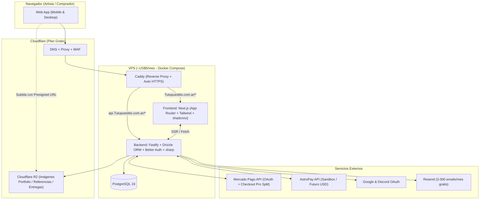
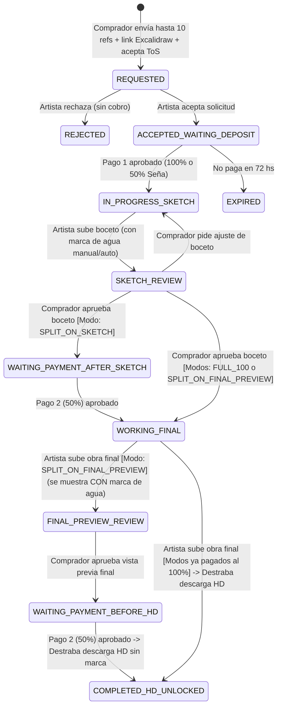
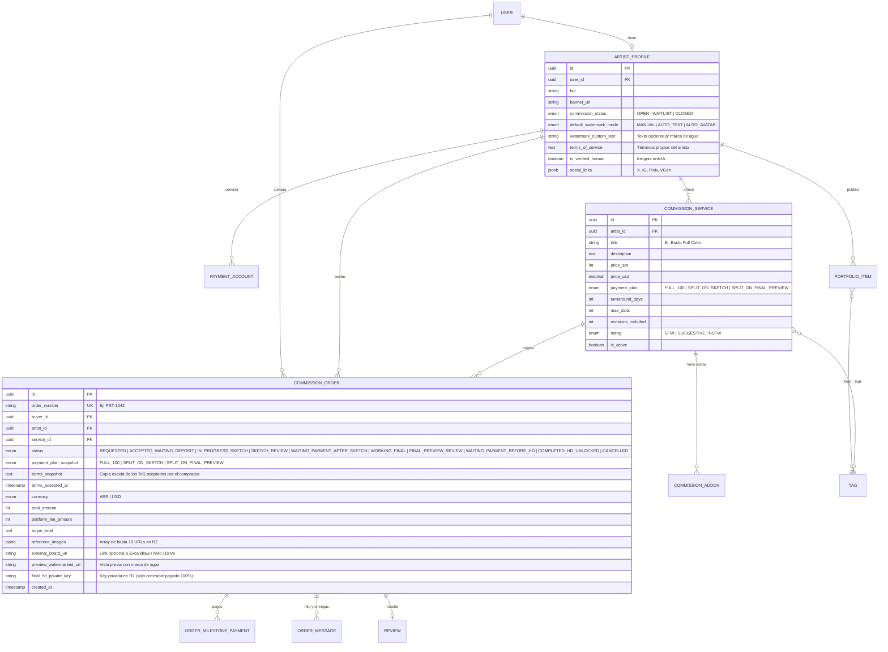

# 🛠️ Plan Técnico del MVP: TuPuestito (v2)

> [!NOTE]
> **Cambios aplicados en esta versión:**
> 1. **Backend definido:** **Fastify** + TypeScript + **Drizzle ORM** (ultra liviano y tipado de punta a punta).
> 2. **Comparativa Supabase vs. PostgreSQL + Better Auth:** por qué PostgreSQL puro te ahorra ~2 GB de RAM en el VPS (y cómo usar Supabase Cloud gratis si igual lo preferís).
> 3. **Investigación de NSFW en Mercado Pago:** diferencia legal entre Mercado Libre y Checkout Pro para servicios digitales, y cómo manejar el +18 sin que bloqueen cuentas.
> 4. **Marca de agua automática (`sharp`):** el artista elige entre *Manual*, *Automática con su Avatar* o *Automática con su Nombre de artista*.
> 5. **Momento del 2° pago configurable por el artista:** *Al aprobar el boceto* vs. *Al aprobar la vista previa final con marca de agua* (con aceptación explícita del comprador antes de iniciar).
> 6. **Formulario de solicitud ampliado:** hasta **10 imágenes de referencia** + **campo de link a tablero externo** (sugiriendo Excalidraw, PureRef Web, Miro o Google Drive).

---

## 1. Arquitectura y Stack: Fastify + ¿Supabase o PostgreSQL puro?

### 🧐 ¿Conviene usar Supabase (Cloud o Self-Hosted) o PostgreSQL en Docker?

Averigüé los requisitos oficiales de **Supabase Self-Hosted**: levanta **entre 12 y 16 contenedores Docker** (Postgres, Kong API Gateway, GoTrue Auth, PostgREST, Realtime, Storage, Studio, Logflare, etc.) y consume **1,5 GB a 3 GB de RAM en reposo** (pide mínimo 4 GB de RAM, que es un VPS más caro). Además, si ya vas a tener tu propio backend en **Fastify**, el 80% de lo que trae Supabase (PostgREST, Edge Functions, Storage propio) queda redundante.

Tenés **2 caminos excelentes**:

| Opción | Qué incluye | Consumo de RAM en tu VPS | Pros y Contras |
|---|---|---|---|
| **Opción A (Recomendada): PostgreSQL 16 en Docker + `Better Auth` en Fastify** | Contenedor único de Postgres + librería `Better Auth` integrada en tu API Fastify | **~120–200 MB RAM** (corre sobrado en el VPS más barato de US\$4–5/mes) | **Pros:** Cero límites, latencia 0 ms (misma máquina que Fastify), `Better Auth` te da Login con Google/Discord/Email en 50 líneas de código y guarda las sesiones en tus propias tablas de Postgres. **Contra:** No tenés el panel visual de Supabase Studio (pero tenés **Drizzle Studio** gratis con 1 comando). |
| **Opción B: Supabase Cloud (Free Tier) para DB + Auth** | Base de datos y Auth hosteados en la nube gratis de Supabase; tu VPS solo corre Next.js + Fastify | **0 MB en tu VPS** | **Pros:** Panel web lindo y Auth ya armado. **Contras del Free Tier:** Límite de 500 MB de base de datos, **se pausa el proyecto si hay inactividad**, y si tu VPS está en una región distinta a la de Supabase, cada query de Fastify tiene latencia de red. |

> [!TIP]
> **Mi recomendación:** Usá **PostgreSQL 16 directo en Docker + `Better Auth` + `Drizzle ORM`**. Con `npx drizzle-kit studio` tenés una interfaz visual idéntica a la de Supabase para ver y editar tablas, gastás casi nada de RAM en el VPS y no dependés de ningún servicio externo que te pause la base o te cobre US\$25/mes cuando pases los 500 MB.

### Diagrama de Arquitectura (Stack cerrado con Fastify)

---

## 2. Investigación: Contenido Adulto / NSFW en Mercado Pago y AstroPay

Investigué los **Términos y Condiciones de Mercado Pago (Checkout Pro)** frente a lo que pasa en Mercado Libre:

1. **¿Por qué en Mercado Libre hay juguetes sexuales pero en Mercado Pago bloquean el NSFW?**
   - Mercado Libre tiene una categoría física ("Adultos") regulada para bienes físicos específicos (como lencería o juguetes sexuales).
   - Sin embargo, en los **Términos y Condiciones de Mercado Pago para procesamiento de pagos (Checkout Pro / Links de pago)** está **estrictamente prohibido** cobrar por *"material pornográfico, contenido erótico explícito digital, packs de fotos/videos o servicios adultos"*. Esto viene impuesto por las reglas de **Visa y Mastercard** para procesadores de pago (las mismas reglas que obligaron a OnlyFans, Patreon, Pixiv/BOOTH y VGen a restringir o separar pasarelas).
   - **El riesgo real:** Si en el concepto de pago de Mercado Pago (`items[].title`) o en la URL pública auditada aparece *"Comisión NSFW +18 / Hentai / Explícito"*, los bots de compliance de Mercado Pago pueden **congelar la cuenta del artista y/o la cuenta de tu Marketplace**.
2. **¿Cómo lo resolvemos en TuPuestito sin perder a los artistas y sin arriesgar la pasarela?**
   - **Tres niveles de clasificación en la plataforma:**
     - `SFW` (Apto para todo público): 100% permitido con Mercado Pago y AstroPay.
     - `SUGGESTIVE` (Ecchi suave, trajes de baño, poses sugerentes o desnudez artística no explícita): permitido, con filtro de vista previa opcional.
     - `NSFW_EXPLICIT` (+18 sexualmente explícito):
       - **En el MVP (mientras solo esté Mercado Pago):** Podés permitir que el artista muestre en su portfolio que hace NSFW (bajo filtro +18 para mayores de edad), pero **para pedidos pagados por Mercado Pago exigir que sean SFW/Suggestive**, **O BIEN** que los conceptos de cobro enviados a la API de Mercado Pago sean siempre neutros (ej. `"Encargo de ilustración digital #PST-1042 — @artista"`) y que las entregas +18 viajen **exclusivamente dentro del hilo privado del pedido** y nunca en URLs públicas indexables.
       - De todas formas, en los **Términos de TuPuestito** prohibimos de forma absoluta cualquier contenido ilegal (menores/loli/shota, no consensuado, bestialismo, gore extremo), igual que hacen VGen y Pixiv.

---

## 3. Marca de Agua Automática y Momento del 2° Pago Configurable

### A. Sistema de Marca de Agua Automática (con `sharp` en Fastify)
En la configuración de su perfil (y al subir un boceto o vista previa final en el pedido), el artista elige su **Modo de Marca de Agua**:

| Modo | Cómo funciona técnicamente |
|---|---|
| **1. Manual (`MANUAL`)** | El artista sube la imagen ya con su propia marca de agua puesta desde Clip Studio / Photoshop. El servidor solo la convierte a `WebP` optimizado. |
| **2. Automática con Nombre (`AUTO_TEXT`)** | El artista sube su imagen limpia y Fastify genera al vuelo con `sharp` una capa SVG semitransparente repetida en diagonal (patrón *tiled* a 30° de opacidad) que dice `@username • MUESTRA TuPuestito - NO USAR`, imposible de recortar. |
| **3. Automática con Foto de Perfil (`AUTO_AVATAR`)** | Fastify toma el avatar del artista, lo convierte en un sello semitransparente con su `@username` debajo y lo estampa en mosaico sobre toda la ilustración de muestra. |

> [!IMPORTANT]
> **Doble archivo en la entrega final:** Cuando el artista sube la entrega final, el backend guarda **dos archivos en Cloudflare R2**:
> 1. `preview_watermarked.webp`: con la marca de agua elegida por el artista, que se muestra en el chat del pedido.
> 2. `original_hd.png / .zip`: en el bucket privado. **El link de descarga de este archivo original jamás se envía al navegador del comprador hasta que el pago del 100% figura `APPROVED` en la base de datos.**

---

### B. Configuración de cuándo se hace el 2° Pago (y aceptación en los Términos)

Al crear o editar cada servicio de comisión, el artista configura su **Plan de Cobro**:

1. **`FULL_100` (100% al inicio):** Pago único al aceptar la solicitud, antes de empezar a dibujar.
2. **`SPLIT_ON_SKETCH` (50% al inicio + 50% al aprobar el boceto):**
   - El comprador paga 50% para que el artista empiece.
   - El artista sube el boceto (con marca de agua).
   - Al tocar *"Aprobar boceto"*, el comprador paga el 50% restante para que el artista pase a línea/color y entregue el final.
3. **`SPLIT_ON_FINAL_PREVIEW` (50% al inicio + 50% con el dibujo terminado antes de descargar sin marca de agua):**
   - El comprador paga 50% para que el artista empiece.
   - El artista sube el boceto → el comprador lo aprueba (sin pagar todavía).
   - El artista termina el dibujo y sube la ** Entrega Final**, que el comprador ve **con la marca de agua automática/manual en baja resolución**.
   - El comprador aprueba el resultado final y **recién ahí paga el segundo 50%**.
   - Apenas entra el webhook de Mercado Pago, se desbloquea automáticamente la descarga del archivo original HD sin marca de agua.

#### Aceptación contractual antes de pedir la comisión
En el formulario de solicitud (`/u/[username]/request/[serviceId]`), antes del botón *"Enviar solicitud"*, el comprador ve un recuadro destacado con las reglas exactas de ese servicio y debe marcar un checkbox obligatorio:
> ☑️ *"Entiendo y acepto los Términos de Servicio de **@artista** y la modalidad de pago elegida (**50% de seña al aceptar el pedido y 50% al [aprobar el boceto / aprobar la vista previa final con marca de agua]**). Entiendo que la seña inicial no es reembolsable una vez entregado el boceto."*

Cuando se crea el pedido (`COMMISSION_ORDER`), guardamos una **copia inmutable (snapshot)** de esa regla y de los términos del artista vigentes en ese minuto, para que si el artista cambia sus reglas un mes después, el pedido conserve exactamente lo que ambos pactaron.

---

## 4. Máquina de Estados Actualizada (Soportando las 3 Modalidades)

---

## 5. Modelo de Datos Actualizado (PostgreSQL + Drizzle ORM)

---

## 6. Detalle del Formulario de Solicitud (`/u/[username]/request/[serviceId]`)

1. **Resumen claro de condiciones arriba de todo:**
   - Precio base + extras seleccionados.
   - Modalidad elegida por el artista: **100% al inicio**, **50/50 al aprobar boceto** o **50/50 al aprobar vista previa final**.
   - Plazo estimado de entrega y cantidad de revisiones incluidas.
2. **Descripción del pedido (`buyer_brief`):**
   - Guía con placeholders útiles (*"Personalidad del personaje, pose deseada, expresión, detalles importantes que no deben faltar..."*).
3. **Referencias visuales (hasta 10 imágenes):**
   - Zona *drag & drop* que permite subir hasta **10 imágenes** (`PNG`, `JPG`, `WebP`, máx. 5 MB c/u) directo a Cloudflare R2.
4. **Link a tablero externo (`external_board_url` - Opcional):**
   - Input para pegar un enlace con validación de URL segura y un texto de ayuda amigable:
     > 💡 *¿Querés explicarle mejor la pose o composición al artista? Te recomendamos armar un lienzo gratis en **[Excalidraw](https://excalidraw.com)**, Miro o Google Drive y pegar el link compartido acá.*
5. **Términos del Artista + Checkbox de aceptación legal:**
   - Acordeón desplegable con los Términos de Servicio del artista y el checkbox obligatorio que guarda `terms_snapshot` y `terms_accepted_at`.

---

## 7. Hoja de Ruta de Construcción (6 Sprints con Fastify + Drizzle)

| Sprint | Foco | Entregable concreto |
|---|---|---|
| **Sprint 1** | **Monorepo, Fastify, DB y Auth** | Estructura `pnpm` (`apps/web`, `apps/api`, `packages/shared`), Docker Compose con PostgreSQL 16, **Fastify + Drizzle ORM + Better Auth** (Google, Discord, Email). |
| **Sprint 2** | **Perfil-Tienda, Portfolio y Marca de Agua** | Subida a Cloudflare R2, motor de **marca de agua automática en Fastify (`sharp`: Manual, Texto o Avatar)**, perfil `/u/[username]` con SEO/OpenGraph, tags y filtro SFW/NSFW. |
| **Sprint 3** | **Catálogo de Comisiones y Buscador** | Configuración de servicios de comisión (con las 3 modalidades: `FULL_100`, `SPLIT_ON_SKETCH`, `SPLIT_ON_FINAL_PREVIEW`), Términos del artista, y Home con buscador y filtros. |
| **Sprint 4** | **Solicitud (10 refs + Excalidraw) y Sala del Pedido** | Formulario de solicitud con hasta 10 imágenes + link a tablero externo + snapshot de ToS; máquina de estados completa, hilo de mensajes, subida de bocetos y entrega final bloqueada con vista previa marcada. |
| **Sprint 5** | **Mercado Pago Split OAuth + Webhooks** | Vinculación OAuth de la cuenta de MP del artista (tokens cifrados AES-256-GCM), generación de preferencias con `marketplace_fee` del 5% (con concepto neutro seguro) y desbloqueo automático del archivo HD tras el pago final. |
| **Sprint 6** | **Notificaciones, Legales y Deploy al VPS** | Emails con Resend + Webhooks de Discord, reseñas, páginas legales, y deploy con Docker Compose + Caddy en el VPS. |

---

## ¿Arrancamos con el Sprint 1?
Si esta versión v2 del plan técnico está como la querés, dale a **Proceed** (o confirmame por chat) y te dejo creado y funcionando el esqueleto del monorepo en `f:\repos\TuPuestito` con **Next.js + Fastify + Drizzle + PostgreSQL (`docker-compose.yml`)** para empezar a programar.

